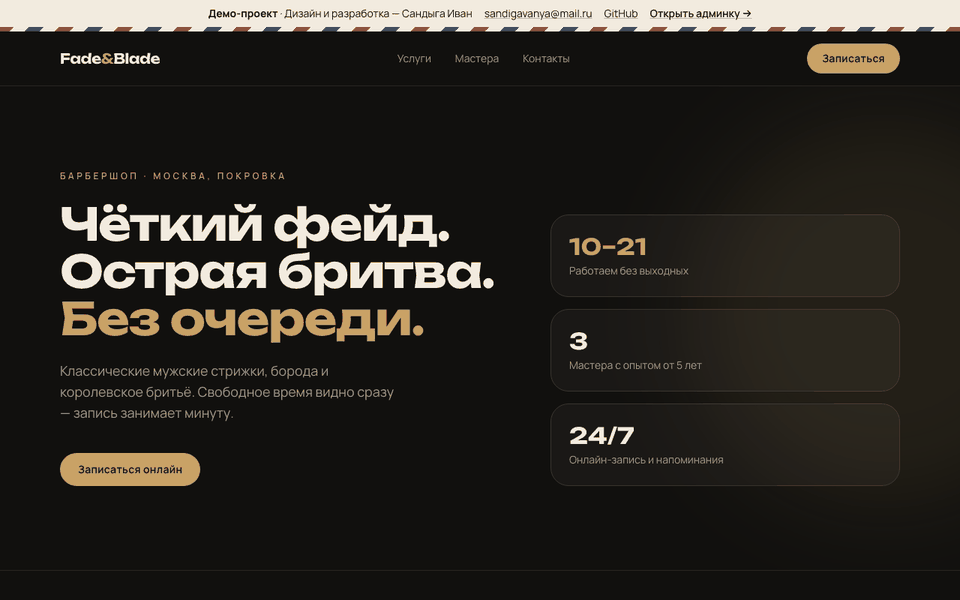
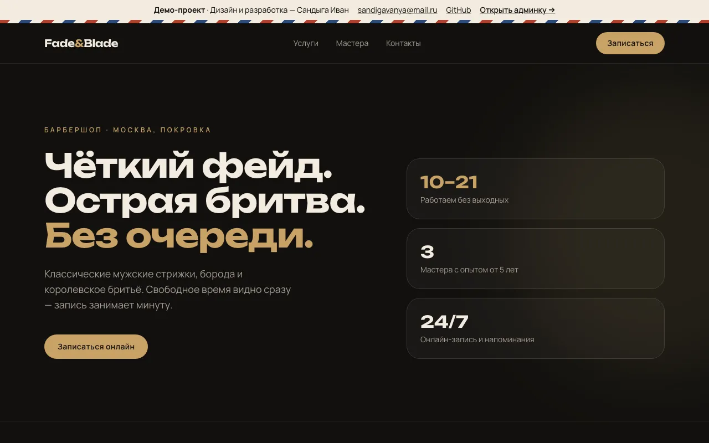
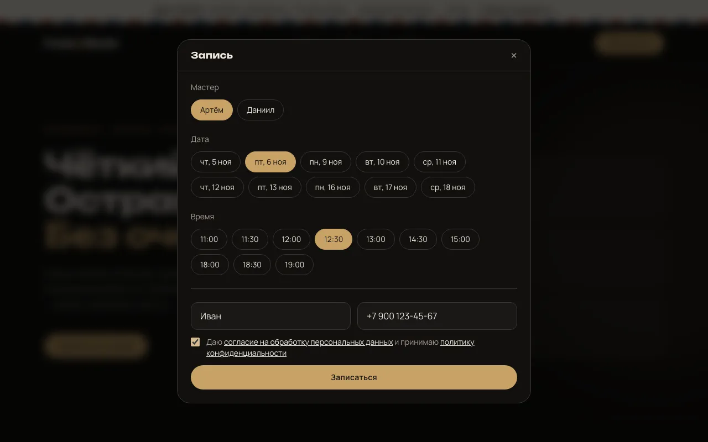
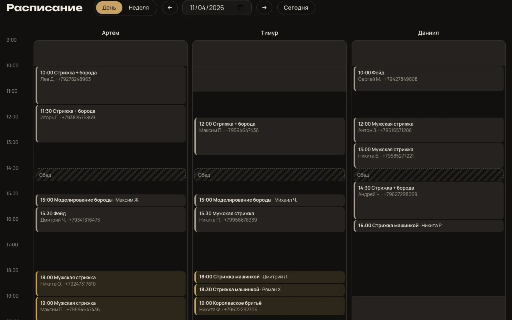
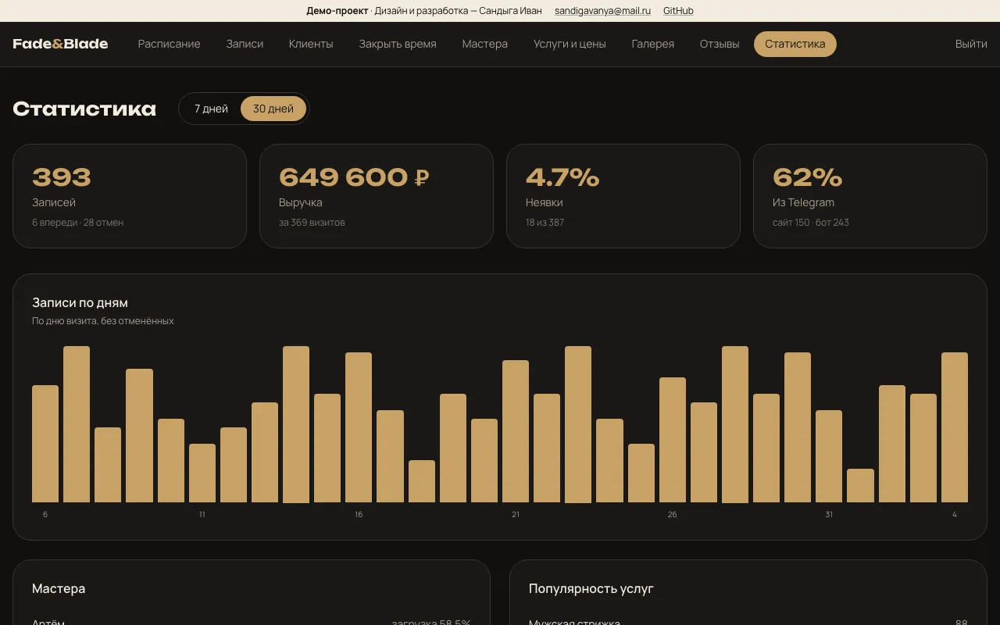

# Fade & Blade — онлайн-запись для барбершопа

[](https://github.com/avesae/barbershop/actions/workflows/ci.yml)

Демо-проект для портфолио: готовая система записи для небольшого барбершопа или салона.

- **Лендинг**: услуги, цены, мастера с фото, галерея работ, отзывы и запись прямо на сайте.
- **Telegram-бот**: запись, перенос, отмена, напоминания, отзывы, повторная запись, лист ожидания и удаление данных.
- **Telegram Mini App**: запись с календарём внутри Telegram.
- **Кабинет мастера в боте**: расписание на день, отметки «пришёл / не пришёл», закрытие времени.
- **Админка**: расписание, записи, клиенты с историей, мастера и график, услуги, галерея, модерация отзывов, статистика.

Всё поднимается одной командой `docker compose up` на любом VPS. Данные хранятся в PostgreSQL на вашем сервере, без Google Таблиц и сторонних CRM. Есть ежедневные бэкапы.

> Дизайн и разработка — Сандыга Иван · [sandigavanya@mail.ru](mailto:sandigavanya@mail.ru) · [GitHub](https://github.com/avesae)



| | |
|---|---|
|  |  |
|  |  |

## Возможности

**Для клиента**
- Запись за минуту на сайте, в боте или в Mini App. Видно только свободное время, двойная запись невозможна.
- Напоминания за 24 и за 2 часа с кнопками «Перенести» и «Отменить».
- **Отзыв после визита.** Через 3 часа бот просит оценку от 1 до 5.
- **Повторная запись.** Через заданное для услуги время (по умолчанию 28 дней) бот предлагает записаться к тому же мастеру.
- **Лист ожидания.** Нет удобного дня — бот напишет, как только освободится время. Кто первый нажмёт, тот и записан.
- «Удалить мои данные» в один клик (152-ФЗ).

**Для мастера** (кабинет в том же боте)
- Расписание на сегодня и завтра с заметками о клиентах («короче на висках»).
- Отметки «пришёл / не пришёл».
- Закрыть время: обед, выходной или интервал вида «14-15».
- Уведомления о своих новых записях, переносах и отменах.

**Для владельца** (админка `/admin`)
- **Расписание:** день и неделя по мастерам, обеды и выходные.
- **Записи:** список с фильтрами, отмена, отметки визитов.
- **Клиенты:**
  - поиск по имени и телефону;
  - карточка с историей визитов, суммой, частотой посещений, неявками, заметками и статусом согласия.
- **Мастера:**
  - фото и описание;
  - график по дням недели, можно с перерывом;
  - услуги мастера;
  - ссылка-приглашение в бот.
- **Услуги и цены**, интервал повторной записи.
- **Галерея работ:** загрузка фото, они автоматически ужимаются в webp.
- **Отзывы:** модерация. Оценки 1–3 сразу приходят владельцу в Telegram и на сайт не попадают.
- **Статистика за 7 и 30 дней:**
  - записи по дням и выручка;
  - загрузка каждого мастера в процентах от рабочего времени;
  - доля неявок;
  - доля записей из Telegram;
  - популярность услуг.

## Стек

| Часть | Технологии |
|---|---|
| API | Python 3.12, FastAPI, SQLAlchemy 2 (async), asyncpg, Pillow |
| БД | PostgreSQL 16 |
| Бот | aiogram 3 |
| Фронтенд | HTML, Tailwind CSS 4, чистый JavaScript; раздаёт nginx |
| Инфраструктура | Docker Compose, GitHub Actions |

```
┌──────────┐  /api, /uploads  ┌────────┐      ┌────────────┐     ┌────────┐
│  web     │ ───────────────► │  api   │ ───► │ PostgreSQL │ ◄── │ backup │ pg_dump раз в сутки
│ (nginx)  │                  │FastAPI │      └────────────┘     └────────┘
└──────────┘                  └────────┘            ▲
 лендинг, /admin, /app (Mini App)                   │
                              ┌────────┐            │
 Telegram ◄─────────────────► │  bot   │ ───────────┘
                              │aiogram │  фоновые задачи раз в минуту:
                              └────────┘  напоминания, отзывы, повторная запись, лист ожидания
```

API и бот используют общие модули бизнес-логики: `backend/app/booking.py` и `backend/app/engagement.py`. Поэтому правила записи одинаковы на сайте, в боте и в Mini App.

## Быстрый старт

Нужны Docker и Docker Compose. На Mac подойдёт [OrbStack](https://orbstack.dev) или Docker Desktop.

```bash
git clone https://github.com/avesae/barbershop.git
cd barbershop
cp .env.example .env      # заполните пароли и токен бота
docker compose up --build
```

- сайт: http://localhost
- админка: http://localhost/admin (логин и пароль из `ADMIN_USER` и `ADMIN_PASSWORD`)
- документация API: http://localhost/api/docs

При первом запуске создаются таблицы и стартовые данные: 3 мастера, 6 услуг и график. Чтобы сразу увидеть систему «в работе» с историей записей, клиентами и отзывами, включите [демо-режим](#демо-режим).

Если `BOT_TOKEN` не задан, контейнер бота не падает, а пишет в лог предупреждение. Сайт и админка при этом работают.

## Настройка Telegram-бота

1. Откройте [@BotFather](https://t.me/BotFather) и выполните `/newbot`. Придумайте имя и username, который заканчивается на `bot`.
2. Скопируйте токен в `.env`:
   ```
   BOT_TOKEN=1234567890:AA...
   BOT_USERNAME=fade_and_blade_bot   # без @
   ```
3. Узнайте свой chat id, например через [@userinfobot](https://t.me/userinfobot), и укажите его, чтобы получать уведомления о новых записях:
   ```
   ADMIN_CHAT_ID=123456789
   ```
   Это может быть и id группы. Тогда добавьте бота в группу; id группы начинается с `-100`.
4. Перезапустите бота:
   ```bash
   docker compose up -d bot
   ```
5. Напишите боту `/start`.

Токен хранится только в `.env`, а этот файл в git не попадает.

### Кабинет мастера

В админке откройте «Мастера», нажмите «Пригласить в бот» и отправьте мастеру ссылку. Она одноразовая: после перехода мастер видит в боте своё меню.

### Mini App

Telegram открывает Mini App только по HTTPS. Когда сайт доступен по домену (см. [деплой](#деплой-на-vps)), укажите в `.env` адрес `SITE_URL=https://ваш-домен.ru` и перезапустите бота. Тогда в меню бота появится кнопка «Записаться», которая открывает `/app`. Каждый запрос Mini App подписан Telegram (`initData`), и API проверяет подпись.

### Запись с сайта и Telegram

Клиенту, который записался на сайте, показывается кнопка «Получать напоминания». Она открывает бота по ссылке `t.me/<бот>?start=<код>`, и запись привязывается к Telegram.

## Деплой на VPS

Подойдёт любой VPS в России: Timeweb Cloud, Selectel, Yandex Cloud, REG.RU. Хватит 1 vCPU и 1 ГБ RAM, ОС — Ubuntu 22.04 или 24.04.

```bash
# 1. Docker
curl -fsSL https://get.docker.com | sh

# 2. Код и настройки
git clone https://github.com/avesae/barbershop.git && cd barbershop
cp .env.example .env && nano .env   # пароли, токен, SITE_URL=https://ваш-домен.ru

# 3. Запуск в фоне
docker compose up -d --build
```

### Домен и HTTPS

Направьте A-запись домена на IP сервера. Проще всего получить HTTPS через [Caddy](https://caddyserver.com): он сам выпускает сертификаты Let's Encrypt.

1. В `.env` перенесите сайт на внутренний порт: `WEB_PORT=8080`.
2. Установите Caddy (`apt install caddy`) и пропишите в `/etc/caddy/Caddyfile`:
   ```
   ваш-домен.ru {
       reverse_proxy localhost:8080
   }
   ```
3. Примените настройки: `systemctl reload caddy && docker compose up -d`.

### Бэкапы

Контейнер `backup` раз в сутки делает `pg_dump` в папку `./backups` и удаляет копии старше `BACKUP_KEEP_DAYS` (по умолчанию 14 дней). Папку стоит периодически забирать на другой сервер или в S3 с хранением в РФ.

Восстановление:

```bash
gunzip -c backups/barber-20261104-0400.sql.gz | docker compose exec -T db psql -U barber barber
```

Перед восстановлением в непустую базу пересоздайте её. Учтите, что `docker compose down -v` удаляет volume с данными.

### Обслуживание

```bash
docker compose logs -f bot                    # логи бота
git pull && docker compose up -d --build      # обновление
```

Схема БД создаётся при старте (`create_all`), миграций пока нет. Если после обновления в моделях появились новые поля, существующую базу нужно доработать вручную или подключить Alembic.

## Демо-режим

Для портфолио-витрины поставьте `DEMO_MODE=true`. Тогда:

- в базе появятся около 200 клиентов, история записей за 30 дней и записи на неделю вперёд, обеды, опубликованные отзывы и лист ожидания;
- на странице входа в админку есть подсказка с логином и паролем, а в демо-полоске сайта — ссылка «Открыть админку»;
- каждую ночь в 04:00 база и загруженные фото сбрасываются к исходному демо-состоянию.

**Не включайте демо-режим на настоящем барбершопе**: данные будут стираться каждую ночь.

## 152-ФЗ: как соблюдены требования

| Требование | Где реализовано |
|---|---|
| **Согласие до сбора данных** | Бот показывает текст согласия с кнопкой «✅ Согласен» до того, как спросить имя и телефон. Так же устроены лист ожидания и Mini App. На сайте форма не отправится без галочки, а API отклоняет запрос без `consent: true`. |
| **Фиксация согласия** | Таблица `consents` хранит клиента, время согласия, версию текста (`CONSENT_VERSION` в `app/consent.py`) и источник. Статус согласия виден в карточке клиента. Если поднять версию, бот запросит согласие заново. |
| **Хранение в РФ** | Данные и фото лежат в PostgreSQL и volume на вашем сервере, бэкапы тоже на нём. Сторонних хранилищ, Google Таблиц, CRM и счётчиков аналитики нет. Шрифты отдаются со своего сервера. |
| **Отзыв согласия и удаление** | Кнопка «🗑 Удалить мои данные» и команда `/delete_me` в боте. Будущие записи отменяются, имя, телефон, Telegram ID, согласия, отзывы и лист ожидания удаляются, а прошлые визиты остаются обезличенными для статистики (`delete_client_data`). |
| **Политика конфиденциальности** | Страница `/privacy.html`: состав данных, цели, основание, место и сроки хранения, права субъекта, полный текст согласия. Ссылки есть в форме записи, в подвале сайта и в боте. |
| **Минимум данных** | Собираются только имя, телефон и Telegram ID. |
| **Доступ** | Админка закрыта логином и паролем, `/admin` и `/app` закрыты от индексации. Подпись Mini App проверяется на сервере. |

Что остаётся сделать владельцу настоящего бизнеса (код этого не решает):

- подать уведомление в Роскомнадзор об обработке ПДн;
- указать в политике реальные реквизиты оператора (ИП или ООО) и контакт для запросов;
- назначить ответственного за обработку ПДн.

## Разработка без Docker

```bash
python3.12 -m venv .venv
.venv/bin/pip install -r backend/requirements-dev.txt
cd web && npm install && npm run build && cd ..

# API + сайт на SQLite: http://localhost:8000
cd backend
STATIC_DIR=../web/dist DATABASE_URL=sqlite+aiosqlite:///./dev.db ../.venv/bin/uvicorn app.main:app --reload

# бот (в отдельном терминале, нужен BOT_TOKEN)
DATABASE_URL=sqlite+aiosqlite:///./dev.db BOT_TOKEN=... ../.venv/bin/python -m bot.main
```

## Тесты

```bash
cd backend && ../.venv/bin/python -m pytest    # 76 тестов
./scripts/smoke.sh                             # смоук поднятого docker compose
```

- `test_slots.py`, `test_reminders.py`, `test_stats.py`: чистая логика. Слоты, пересечения, обед, отступ от текущего времени, сроки напоминаний, загрузка мастеров, неявки.
- `test_booking.py`: запись, защита от двойной записи, перенос, отмена, телефоны, удаление данных.
- `test_bot.py`, `test_engagement.py`: сценарии бота целиком через диспетчер aiogram с подменой Telegram API. Покрыты запись, перенос, отмена, кабинет мастера, отзывы, повторная запись, лист ожидания и напоминания.
- `test_tg_app.py`: подпись `initData` и запись через Mini App.
- `test_api.py`, `test_admin_extra.py`, `test_demo.py`: API, админка, загрузка фото, демо-данные.

CI на GitHub Actions на каждый пуш прогоняет pytest, собирает все образы, поднимает `docker compose` и запускает смоук-тест на настоящем PostgreSQL. В тесте 5 одновременных запросов на один слот, и успешным должен быть ровно один: это гарантирует ограничение `EXCLUDE USING gist` в базе.

## Структура

```
backend/
  app/
    slots.py, reminders.py, stats.py   чистая логика (без БД)
    booking.py                         запись, перенос, отмена, удаление данных
    engagement.py                      кабинет мастера, отзывы, повторная запись, лист ожидания
    telegram_auth.py                   проверка подписи Mini App
    demo.py                            демо-данные и ночной сброс
    routers/                           public, tg_app, admin*, …
  bot/                                 handlers.py (клиент), master.py (мастер), jobs.py (рассылки)
  tests/
web/src/                               index.html, privacy.html, admin/, app/ (Mini App), js/, css/
scripts/                               backup.sh, smoke.sh
docker-compose.yml
```
